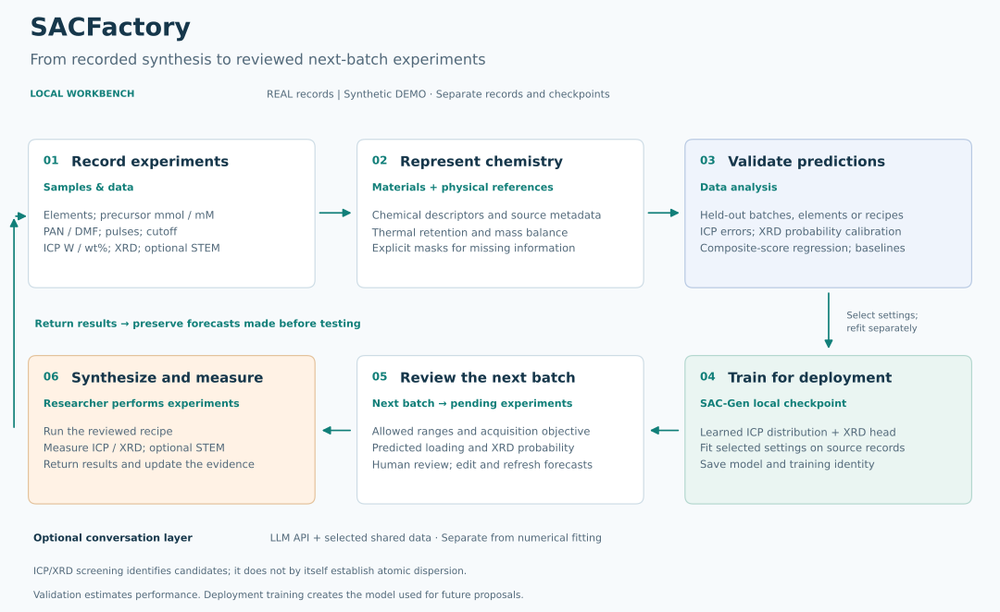

# SACFactory

**A local experiment workbench for single-atom catalyst synthesis.**

SACFactory connects recipe recording, chemical descriptors, model evaluation and
next-batch planning. Its SAC-Gen workflow predicts continuous ICP metal content
and the probability of an XRD PASS judgment. Researchers review proposals,
perform experiments and return measured results to the same workspace.

## Deploy locally with Codex

**No programming experience is required for the Codex-assisted route.** You
describe the task; Codex handles local commands and explains any missing tools.
Choose the route that suits you:

| Route | Best for | What you do |
| --- | --- | --- |
| **A. Ask Codex to deploy** | First-time users without coding experience | Open a local folder and paste the request below |
| **B. Download ZIP, then ask Codex** | Users who prefer downloading through GitHub | Download and extract the source, open that folder in Codex, and request setup |
| **C. Install manually** | Users comfortable with a terminal | Follow the Windows or macOS/Linux commands in the installation guide |

Open a local folder in Codex and paste this request. Codex installs the software
on **your computer**; SACFactory then opens in your browser.

```text
Deploy https://github.com/OscarLan-Fei/SACFactory locally in this workspace.
Read INSTALL_WITH_CODEX.md and README.md first. Inspect the operating system,
Git and Python availability; use Python 3.12 and an isolated .venv environment.
Install requirements.txt, check the dependencies, and launch app.py with
Streamlit on 127.0.0.1:8517. If that port belongs to another application, use a
free local port without stopping it. Verify /_stcore/health and give me the URL,
installation path, and exact commands to start and stop it later. Use DEMO for
the first check. Preserve existing records, credentials and checkpoints. Do not
upload local files or start expensive model training during installation.
```

See [Local deployment with Codex](INSTALL_WITH_CODEX.md) for the full walkthrough,
manual commands and troubleshooting. Codex is an optional setup assistant; the
installed numerical workbench runs without Codex or a language-model API.
The optional in-app research conversation has separate provider settings.

## Overall concept



**Scheme 1.** A researcher-led experiment loop. Validation produces held-out
evidence; a separate deployment fit produces the local checkpoint used for
future recipes. REAL and synthetic DEMO remain separate throughout.
[PNG](SACFactory-overview.png) · [Editable workflow source](SACFactory-overview.mmd).

## What each workspace does

| Workspace | Purpose | Typical output |
| --- | --- | --- |
| **Experiment chat** | Local experiment shortcuts, or an optional API-backed conversation with selected data | Explanations, tables and proposed actions |
| **Samples & data** | Enter, import, edit and delete recipes; manage pending experiments and return results | Sample records and saved forecasts |
| **Materials & consumables** | Maintain precursor identities, chemical states and preparation materials | Editable material declarations and reference metadata |
| **Next batch** | Search allowed conditions with the available planner or a trained SAC-Gen checkpoint | Reviewed proposals that can be added to pending |
| **Data analysis** | Explore outcomes, assess descriptors, validate predictions and compare models | Plots, paired predictions, metrics and exports |
| **Language model** | Configure an optional compatible API and explicit data sharing | Research conversation connected to selected records |
| **About** | Read the workbench overview and method context | Project orientation |

The [User guide](USER_GUIDE.md) explains all nine analysis tabs, the score plots,
element selection and the complete record-to-prediction workflow.

## A first session

1. Select **Simulated demo · DEMO** to explore the synthetic campaign.
2. Open **Data analysis → Weighted validation**. Select elements, models and a
   validation protocol; run masked validation to obtain held-out predictions.
3. Inspect composite-score, ICP regression and XRD diagnostics separately.
4. Use **Train deployment model** to fit SAC-Gen for future proposals.
5. Open **Next batch**, check the checkpoint and allowed ranges, generate a
   preview and add the batch to pending.
6. Edit pending controls and return results in **Samples & data**. Switch to
   **Real experiments · REAL** when starting your own campaign.

## Quantities and interpretation

- Amounts: **mmol**; concentrations: **mM**; PAN: **g**; DMF: **mL**.
  At 20 mL, **1 mmol = 50 mM**.
- ICP: **W / wt%**. Enter `2.5` for 2.5 wt%. This is continuous metal content,
  not a single-atom fraction.
- Pulse count and controlled cutoff temperature describe synthesis inputs;
  measured peak temperature is a separate observation.
- XRD PASS/FAIL is a recorded judgment. STEM is optional and separate.
  ICP/XRD screening alone does not establish atomic dispersion.
- Outcome scores, post-result agreement scores and probabilities answer
  different questions. See [Understanding the prediction displays](USER_GUIDE.md#understanding-the-prediction-displays).

## Data and model availability

The source includes **1,476 synthetic preparations**, templates, reference
resources and tests. DEMO contains fixed synthetic scatter; values do not change
randomly on page refresh. It demonstrates the software and is not experimental
evidence or an independent model benchmark.

REAL starts in a separate empty local database. This repository excludes the
author's experimental records, raw assays, credentials and private trained
checkpoints. SAC-Gen algorithms are included; train a local deployment checkpoint
using the appropriate data space before using that checkpoint for planning.
Runtime databases and checkpoints are excluded by `.gitignore`.

GitHub hosts the source. Local deployment starts a service on your computer;
publishing the repository does not itself create a hosted application.

## Documentation

- [Local deployment with Codex](INSTALL_WITH_CODEX.md)
- [User guide and module reference](USER_GUIDE.md)
- [Model, physical priors and evaluation methods](METHODS.md)
- [Predictive and acquisition benchmarks](BENCHMARKS.md)
- [Source acknowledgments](CREDITS.md)
